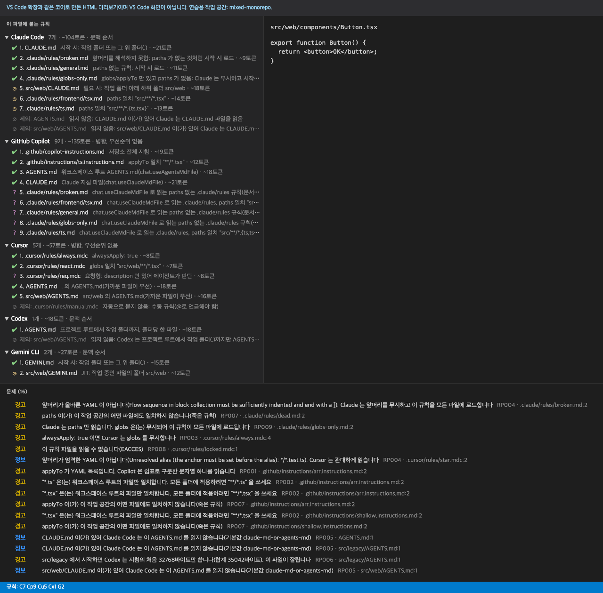
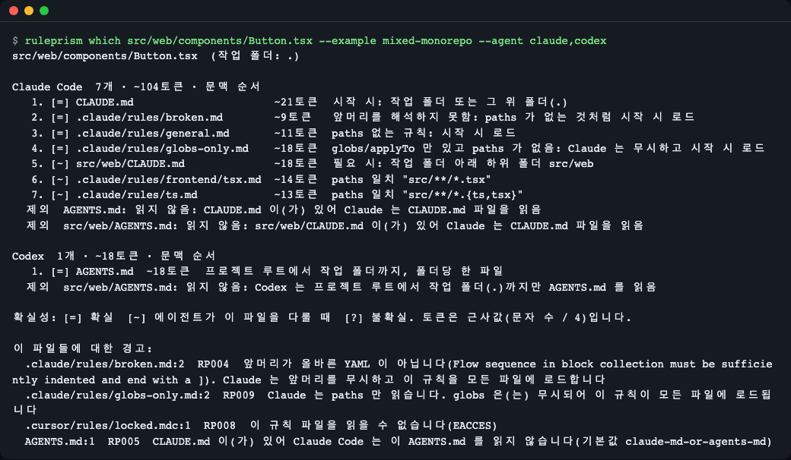
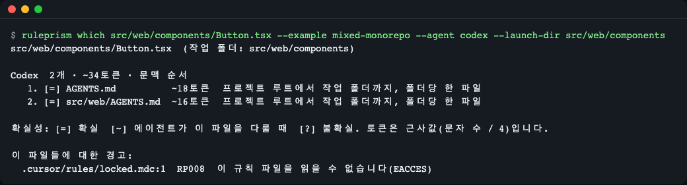
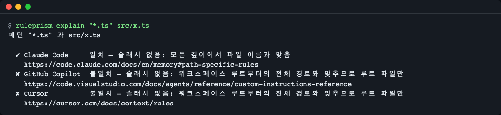
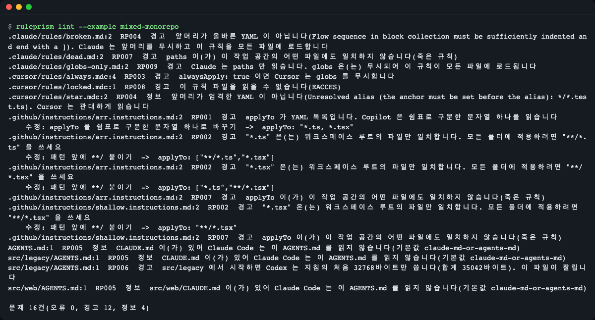
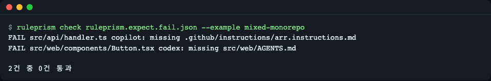
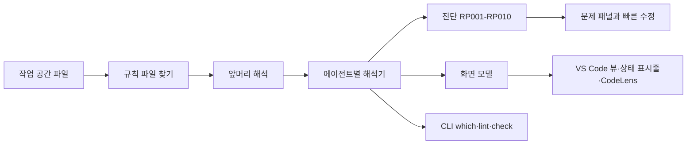

# Ruleprism

[English](README.md) | **한국어**

지금 열어 둔 파일에 Claude Code, GitHub Copilot, Cursor, Codex, Gemini CLI가 어떤 지침 파일을 어떤 순서로, 왜 붙이는지 보여 주는 VS Code 확장입니다(같은 코드를 쓰는 CLI 포함). Copilot이 읽지 못하는 `applyTo` 목록, Claude가 무시하는 `globs` 키처럼 오류 없이 조용히 실패하는 규칙도 짚어 줍니다. 아직 마켓플레이스·npm에는 게시하지 않았습니다. 소스에서 빌드해 `.vsix`로 로컬 설치합니다([설치](#설치) 참고).


*확장과 같은 코어로 만든 HTML 미리보기이며 VS Code 스크린샷이 아닙니다. 이 데모를 위해 만든 연습용 작업 공간 `mixed-monorepo`를 보여 줍니다.*

## 왜 필요한가요

코딩 에이전트마다 규칙 파일이 다르고, 언제 불러오는지도 다릅니다. 같은 `*.ts` 패턴이 `src/x.ts` 에 Claude Code 에서는 일치하지만 Copilot·Cursor 에서는 일치하지 않습니다. Copilot `applyTo` 를 YAML 목록으로 쓰거나 Claude 규칙에 `globs` 키를 쓰면 오류 없이 조용히 실패하고, 에이전트가 규칙을 무시한 뒤에야 알게 됩니다. Ruleprism 은 각 도구가 문서에 밝힌 규칙을 내 파일에 적용해, 에이전트에게 묻기 전에 답을 보여 줍니다.

## 무엇을 더해 주나요

- **이 파일에 붙는 규칙** (영문 표시: Rules for this file): 탐색기 뷰. 열린 파일에 에이전트마다 붙는 지침 파일을 문맥 순서대로, 이유(상위 폴더, 일치한 글롭, `alwaysApply`, 에이전트 요청, 필요할 때 로드)와 대략의 토큰 수와 함께 보여 줍니다.
- **문제(Problems) 패널**: 오류 없이 조용히 실패하는 규칙을 찾는 검사 10개(`RP001`-`RP010`). 그중 2개는 빠른 수정을 제공합니다.
- **실행 폴더 가정**: Claude Code, Codex, Gemini CLI는 어느 폴더에서 띄웠느냐에 따라 읽는 파일이 달라집니다. 폴더를 바꿔 가며 목록이 어떻게 달라지는지 볼 수 있습니다.
- **CI용 CLI**: `ruleprism check` 가 파일마다 기대한 규칙 파일이 붙는지 단언하고, 어긋나면 종료 코드 1을 냅니다.
- 영어·한국어 출력.

판정은 각 도구의 **문서**(2026-11-14 확인)를 따르며, 실행 중인 에이전트를 관찰한 결과가 아닙니다. 판정마다 `[=]` 확실, `[~]` 에이전트가 그 파일을 건드릴 때, `[?]` 불확실 표시가 붙습니다. 출처는 [docs/sources.md](docs/sources.md) 에 있습니다(영어).

## 요구 사항

| 호스트 | 버전 | 비고 |
|---|---|---|
| VS Code | 1.103 이상(`engines.vscode`) | 확장. 실제 VS Code 창에서는 아직 시험하지 않았고, 가짜 `vscode` 모듈로만 확인했습니다([알려진 한계](#알려진-한계) 참고). |
| Node.js | 22.12 이상(26.13.0, npm 11.20.0 으로 빌드·시험) | 빌드와 CLI. 설치: [nodejs.org](https://nodejs.org/) |
| git | 아무 버전 | 레포 clone 용 |

## 설치

Ruleprism 은 아직 VS Code 마켓플레이스나 npm 에 없습니다. 소스에서 빌드하세요.

```bash
git clone https://github.com/LeeGyeongPil/ruleprism.git
cd ruleprism
npm install
npm run package          # ruleprism-0.1.6.vsix 생성
```

npm 11 에서는 `@vscode/vsce-sign` 과 `fsevents` 의 설치 스크립트가 실행되지 않았다는 경고가 보일 수 있습니다. 정상이며 `npm run package` 에는 영향이 없습니다.

`.vsix` 는 VS Code CLI 로 설치하거나, VS Code 명령 팔레트에서 **Extensions: Install from VSIX...** 를 실행합니다.

```bash
code --install-extension ruleprism-0.1.6.vsix
```

VS Code 없이 CLI 만 써 보려면:

```bash
npm start                # 컴파일 후 연습용 작업 공간으로 데모 실행
node out/cli/main.js --help
```

## 빠르게 시작하기

데모를 실행합니다. 도구 안에 들어 있는 연습용 작업 공간(`mixed-monorepo`, 이 데모를 위해 만든 것이며 메모리에서 읽음)을 씁니다.

```bash
npm start
```

같은 연습용 작업 공간을 디스크에 풀어 확장이 설치된 VS Code 로 엽니다.

```bash
node out/cli/main.js demo --write ./ruleprism-demo
code ./ruleprism-demo
```

이 명령은 `Next: cd ./ruleprism-demo && ruleprism which ...` 같은 안내를 출력합니다. clone 한 곳에서는 `npm link` 를 한 번 실행하기 전까지 `ruleprism` 명령이 `PATH` 에 없으므로, 그때까지는 같은 명령을 `node out/cli/main.js which ...` 로 실행하세요.

`src/web/components/Button.tsx` 를 열면 탐색기에 **이 파일에 붙는 규칙**(영문 표시: Rules for this file)이 보이고, 상태 표시줄에 `Rules: C7 Cp9 Cu5 Cx1 G2` 같은 요약(에이전트 글자와 파일 수)이 나옵니다.

## 사용법

### VS Code 안에서

| 위치 | 보이는 것 |
|---|---|
| 탐색기 > **이 파일에 붙는 규칙** (영문: Rules for this file) | 에이전트마다 한 그룹. 항목마다 순서·파일·이유·대략의 토큰 수. 붙지 않는 파일은 이유와 함께 "skipped" 로 표시. |
| 상태 표시줄 | 활성 파일의 에이전트별 파일 수. |
| 규칙 파일 위 CodeLens | 그 규칙이 작업 공간에서 일치하는 파일 수(`0` 이면 죽은 규칙). |
| 문제(Problems) 패널 | `RP001`-`RP010`. `RP001`·`RP002` 는 전구 아이콘으로 빠른 수정. |
| 명령 팔레트 | `Ruleprism: 새로 고침`, `Ruleprism: 패턴 설명…`, `Ruleprism: 결과를 JSON 으로 복사`, `Ruleprism: 작업 폴더 설정…` (영문 VS Code 에서는 `Ruleprism: Refresh`, `Ruleprism: Explain pattern…`, `Ruleprism: Copy result as JSON`, `Ruleprism: Set launch folder…`) |

표시: `✔` 확실, `◷` 에이전트가 이 파일을 건드릴 때, `?` 불확실, `⊘` 붙지 않음.

### 명령줄에서

아래 예시는 `--example` 으로 연습용 작업 공간을 씁니다. 내 레포에는 `--root <폴더>`(기본: 현재 폴더)를 쓰세요. 화면에는 `ruleprism ...` 으로 보이지만, clone 한 곳에서는 `node out/cli/main.js ...` 로 실행합니다(또는 한 번 `npm link`).

**`which`**: 파일 하나에 에이전트마다 어떤 파일이 붙는지.

```bash
node out/cli/main.js which src/web/components/Button.tsx --example mixed-monorepo --agent claude,codex
```


*Claude Code 는 7개를 붙입니다. `src/web/CLAUDE.md` 와 `paths` 규칙 2개는 `[~]` 로, Claude 가 그 파일을 건드릴 때만 로드됩니다. Codex 는 루트 `AGENTS.md` 만 붙입니다.*

**`--launch-dir`**: 에이전트를 다른 폴더에서 띄웠다고 가정합니다.

```bash
node out/cli/main.js which src/web/components/Button.tsx --example mixed-monorepo --agent codex --launch-dir src/web/components
```


*파일이 있는 폴더에서 띄우면 Codex 가 `src/web/AGENTS.md` 도 읽습니다.*

**`explain`**: 글롭 패턴 하나가 도구마다 어떻게 동작하는지.

```bash
node out/cli/main.js explain "*.ts" src/x.ts
```


*같은 `*.ts` 가 `src/x.ts` 에 Claude Code 에서는 일치하고 Copilot·Cursor 에서는 일치하지 않습니다.*

**`lint`**: 조용히 실패하는 규칙을 보고합니다. 경고가 있으면 종료 코드 1을 내므로(`--fail-on error|warning|info|none` 으로 변경) CI 에 쓸 수 있습니다.

```bash
node out/cli/main.js lint --example mixed-monorepo
```


*연습용 작업 공간은 모든 검사가 걸리도록 만들었습니다. 여기서 `lint` 가 종료 코드 1을 내는 것은 의도한 것입니다. `lint --example clean-repo` 는 `No problems found.`(문제 없음) 를 출력하고 0으로 끝납니다.*

| 코드 | 의미 |
|---|---|
| `RP001` | Copilot `applyTo` 를 YAML 목록으로 씀(Copilot 은 쉼표로 이은 문자열 하나를 읽음). 빠른 수정 있음. |
| `RP002` | `*.ts` 처럼 `/` 없는 패턴은 Copilot·Cursor 에서 루트 파일에만 일치(Cursor 는 문서에 명시가 없는 가정이라 info). 빠른 수정: `**/*.ts`. |
| `RP003` | Cursor 에서 `alwaysApply: true` 이면 `globs` 가 의미 없음. |
| `RP004` | 앞머리(front matter)를 해석하지 못함(Claude 는 그 규칙을 모든 파일에 로드). |
| `RP005` | `CLAUDE.md` 가 있어서 Claude Code 가 `AGENTS.md` 를 읽지 않음. |
| `RP006` | Codex 바이트 상한에 걸려 이 파일이 잘림. |
| `RP007` | 패턴이 작업 공간의 어떤 파일에도 일치하지 않음(죽은 규칙). |
| `RP008` | 규칙 파일을 읽을 수 없음. |
| `RP009` | Claude 는 `paths` 만 읽음. Claude 규칙에 쓴 `globs`·`applyTo` 는 무시됨. |
| `RP010` | 작업 공간 파일이 20,000개를 넘어 죽은 규칙(`RP007`) 판정이 부정확할 수 있음. 규칙 파일은 모두 찾음. 안내(info)만. |

**`check`**: CI 에서 판정을 단언합니다. 기대 파일은 파일·에이전트별로 반드시 붙어야 하는 규칙 파일을 적습니다.

```json
{
  "cases": [
    {
      "file": "src/web/components/Button.tsx",
      "agent": "codex",
      "launchDir": "src/web/components",
      "includes": ["src/web/AGENTS.md"],
      "excludes": ["src/legacy/AGENTS.md"]
    }
  ]
}
```

항목의 키: `file`·`agent`(필수), `includes`(반드시 붙어야 하는 규칙 파일), `excludes`(붙으면 안 되는 규칙 파일), `launchDir`(에이전트를 띄웠다고 가정할 폴더, 기본값: 작업 공간 루트). 위 항목은 통과합니다. 실행 폴더를 지정하면 Codex 가 `src/web/AGENTS.md` 를 붙입니다. `launchDir` 이 없으면 같은 항목이 실패합니다. 루트에서 띄운 Codex 는 그 파일을 읽지 않기 때문입니다. 함께 들어 있는 `ruleprism.expect.fail.json` 은 일부러 `launchDir` 을 빼서 실패합니다.

```bash
node out/cli/main.js check ruleprism.expect.fail.json --example mixed-monorepo
```


*종료 코드 1, 빠진 규칙마다 `FAIL` 한 줄. 통과하는 예제 `ruleprism.expect.json` 은 한국어 출력에서 `3건 중 3건 통과`(영어 출력은 `3/3 cases passed`)를 내고 0으로 끝납니다.*

`which`·`lint`·`check` 에 `--json` 을 붙이면 기계가 읽는 출력(`"schemaVersion": 1`)이 나옵니다. 종료 코드: 0 정상, 1 `check` 실패 또는 `lint` 가 문제 발견, 2 사용법·입력 오류(stderr 에 `error:` 와 `hint:` 줄).

### 에이전트별 판정 방식

요약입니다. 출처 URL 이 있는 전체 표는 [docs/sources.md](docs/sources.md) 에 있습니다(영어, 2026-11-14 확인).

| 에이전트 | 무엇을 어떤 순서로 읽나 | 실행 폴더 | 확실성 |
|---|---|---|---|
| Claude Code | 루트부터 실행 폴더까지 `CLAUDE.md` 와 `paths` 없는 규칙(루트가 먼저). 하위 폴더의 `paths` 규칙·`CLAUDE.md` 는 에이전트가 그 파일을 건드릴 때. `AGENTS.md` 는 `CLAUDE.md` 가 없을 때만 | 실행 폴더와 그 위는 시작 시, 아래는 필요할 때 | 시작 시 `[=]`, 필요할 때 `[~]` |
| GitHub Copilot | `.github/copilot-instructions.md`, 일치하는 `.github/instructions/*.instructions.md`(`applyTo`, 작업 공간 루트 기준), 루트 `AGENTS.md`·`CLAUDE.md`(두 설정 모두 기본 켜짐). 합쳐서 붙고 문서에 순서 규칙 없음 | 쓰지 않음 | `applyTo` 목록·`.claude/rules` 는 `[?]` |
| Cursor | `.cursor/rules/*.mdc`: `alwaysApply`, 일치하는 `globs`, 에이전트 요청(`description` 만), 수동 | 쓰지 않음 | description 전용·하위 규칙은 `[?]` |
| Codex | 프로젝트 루트부터 실행 폴더까지 폴더마다 `AGENTS.md`(또는 `AGENTS.override.md`) 하나, 합계 32 KiB 에서 잘림 | 그 아래 폴더는 읽지 않음 | `[=]` |
| Gemini CLI | 실행 폴더부터 `.git` 폴더까지 `GEMINI.md`(시작 시), 열린 파일 폴더의 것은 필요할 때 | 시작 시 읽을 폴더를 정함 | 시작 시 `[=]`, 필요할 때 `[~]` |

### CI 에서 쓰기

`ruleprism check` 는 기대 파일(위 참고)을 읽어 모든 항목이 통과하면 종료 코드 0, 실패하면 1, 사용법·입력 오류면 2 를 냅니다. Ruleprism 은 아직 npm 에 없으므로 아래 작업은 태그가 붙은 릴리스(`v0.1.6`)를 clone 해 빌드한 뒤 내 레포에 `check` 를 실행합니다. `actions/setup-node` 가 Node 를 `PATH` 에 넣어 주며, 액션 버전은 이 레포 자체 CI 가 쓰는 것과 같습니다.

```yaml
name: rules
on: [push, pull_request]
jobs:
  ruleprism:
    runs-on: ubuntu-latest
    steps:
      - uses: actions/checkout@v7.0.1
      - uses: actions/setup-node@v7.1.0
        with:
          node-version: 22.x
      - name: Build ruleprism
        run: |
          git clone --depth 1 --branch v0.1.6 https://github.com/LeeGyeongPil/ruleprism.git "$RUNNER_TEMP/ruleprism"
          cd "$RUNNER_TEMP/ruleprism"
          npm ci
          npm run compile
      - name: Check rule resolution
        run: node "$RUNNER_TEMP/ruleprism/out/cli/main.js" check ruleprism.expect.json
```

같은 단계를 깨끗한 폴더에서 실행해 봤습니다. 빌드 뒤 연습용 작업 공간에 `check ruleprism.expect.json` 은 `3건 중 3건 통과`(영어 출력 `3/3 cases passed`, 종료 0), `check ruleprism.expect.fail.json` 은 `FAIL` 두 줄과 `2건 중 0건 통과`(영어 출력 `0/2 cases passed`, 종료 1, 작업 실패)를 냈습니다. `lint` 단계도 같은 방식으로 더할 수 있습니다(`... lint`, 경고가 있으면 종료 1, `--fail-on` 으로 변경).

### 언어

CLI 언어: `--lang en|ko`, 그다음 `RULEPRISM_LANG`, `LC_ALL`, `LC_MESSAGES`, `LANG` 순(처음 값이 있는 것이 결정, `ko` 로 시작하면 한국어, 그 밖은 영어). 확장: 설정 `ruleprism.language`(`auto` 는 VS Code 표시 언어를 따름).

## 설정

| 키 | 기본값 | 설명 |
|---|---|---|
| `ruleprism.agents` | 5종 전부 | 보여 줄 에이전트: `claude`, `copilot`, `cursor`, `codex`, `gemini`. |
| `ruleprism.launchFolder` | `workspaceRoot` | 에이전트를 띄웠다고 가정할 폴더: `workspaceRoot`, `fileFolder`, 또는 작업 공간 루트 기준 경로. |
| `ruleprism.includeUserFiles` | `true` | `~/.claude/CLAUDE.md`, `~/.claude/rules`, `~/.codex/AGENTS.md`, `~/.gemini/GEMINI.md` 포함. CLI 는 `--user` 일 때만 포함. |
| `ruleprism.claude.instructionFiles` | `claude-md-or-agents-md` | Claude Code "프로젝트 지침" 모드: `CLAUDE.md` 가 없을 때만 `AGENTS.md` 를 읽음, 또는 `claude-md-and-agents-md` 로 둘 다 읽음. |
| `ruleprism.codex.maxBytes` | `32768` | Codex 프로젝트 지침 합계 바이트 상한(`project_doc_max_bytes`). |
| `ruleprism.gemini.fileNames` | `["GEMINI.md"]` | Gemini CLI 문맥 파일 이름. |
| `ruleprism.language` | `auto` | `auto`, `en`, `ko`. |

확장은 Copilot 의 실제 설정 `chat.useAgentsMdFile`·`chat.useClaudeMdFile` 값도 읽습니다. CLI 는 문서에 적힌 기본값(둘 다 켜짐)을 가정합니다.

## 동작 원리



- **찾기와 해석**: 규칙 파일을 찾고(`node_modules`·`.git`·`out`·`dist` 제외, 심볼릭 링크 따라가지 않음. 규칙 파일은 항상 모두 찾고, 죽은 규칙 계산용 일반 파일 목록만 20,000개에서 멈춤) 앞머리를 읽습니다. 깨진 앞머리는 예외 없이 보고만 합니다.
- **에이전트별 해석기**: 도구마다 모듈 하나, 각자 따르는 문서 URL 을 적어 둡니다. 글롭 규칙이 도구마다 달라서, 예를 들어 `*.ts` 는 Claude Code 에서는 어느 깊이든 일치하지만 Copilot·Cursor 에서는 루트에서만 일치합니다.
- **어디서나 같은 코어**: 확장·CLI·HTML 미리보기가 같은 코드를 부릅니다. 코어는 `vscode` 를 가져오지 않습니다(테스트가 확인).
- **접근 범위**: 작업 공간 안의 파일(켜면 위의 몇몇 사용자 수준 경로)만 읽습니다. 네트워크·텔레메트리·자식 프로세스 없음.

## 언제 쓰나

- 잘 맞는 경우: 한 레포에서 코딩 에이전트를 둘 이상 쓰며 편집 중에 각각 어떤 규칙을 받는지 보고 싶을 때, 또는 규칙이 더는 안 붙으면 CI 가 실패하게 하고 싶을 때.
- 다른 도구: "이 파일에 어떤 지침 파일이 적용되나"를 명령줄 답으로만 원한다면 [whichrules](https://github.com/z35068037/whichrules) 를 보세요. 지금 무엇을 다루는지는 그 페이지에서 확인하세요.

## 알려진 한계

- 판정은 문서 기준이며 에이전트를 관찰한 것이 아닙니다. 에이전트 버전에 따라 동작이 바뀔 수 있습니다.
- Cursor 에서 `*.ts` 처럼 `/` 가 없는 패턴은 불일치로 표시하지만 Cursor 문서에는 명시가 없어 가정입니다. `explain` 에서는 아직 `?` 로 표시하지 않습니다.
- Cursor 그룹에는 루트와 하위 폴더의 `AGENTS.md` 가 모두 나타납니다. 이유 문구의 "the closest one wins" 는 지침이 충돌할 때 어느 파일이 우선하는지를 뜻하며, 다른 파일이 빠진다는 뜻이 아닙니다.
- 아직 모델링하지 않은 것: `@path` 가져오기, Claude `claudeMdExcludes`, 관리형 정책 파일, 심볼릭 링크 규칙, Codex `project_doc_fallback_filenames`, Gemini `@file` 가져오기. 전체 목록: [docs/sources.md](docs/sources.md).
- 확장은 가짜 `vscode` 모듈로 시험했습니다(활성화·트리·상태 표시줄·진단·빠른 수정·CodeLens·명령·해제). 실제 VS Code 창이나 확장 호스트 테스트는 아직입니다. README 이미지는 VS Code 스크린샷이 아니라 HTML 미리보기입니다.

## 자주 겪는 문제

| 증상 | 원인 | 해결 |
|---|---|---|
| 뷰가 비어 있음 | 작업 공간에 규칙 파일이 없어 확장이 활성화되지 않음 | `CLAUDE.md`, `AGENTS.md`, `.cursor/rules` 등이 있는 폴더를 여세요. |
| Claude Code 에서 기대한 규칙이 안 보임 | `CLAUDE.md` 때문에 `AGENTS.md` 가 가려짐(`RP005`) | 그 Claude Code 설정을 쓴다면 `ruleprism.claude.instructionFiles` 를 `claude-md-and-agents-md` 로 바꾸세요. |
| Codex 목록이 기대와 다름 | Codex 는 프로젝트 루트부터 실행 폴더까지만 읽음 | `ruleprism.launchFolder` 또는 `--launch-dir` 을 설정하세요. |
| `error: ... is outside the workspace root`(종료 2) | 파일 경로가 `--root` 안에 없음 | 루트 안의 경로를 주거나 `--root` 를 바꾸세요. |
| `error: 작업 공간 ... 에 없는 경로가 있습니다`(`check`, 종료 2) 또는 `경고: ... 없습니다`(`which`, 종료 0) | 기대 파일의 `file`·`launchDir` 또는 `which` 인자가 오타이거나 작업 공간에 없거나 루트 밖(`../…`)임 | 경로를 고치세요. 경로는 작업 공간 루트 기준입니다. `which` 는 아직 만들지 않은 파일을 가정해 볼 수 있도록 경고만 합니다. |
| `code: command not found` | VS Code 셸 명령이 설치되지 않음 | 명령 팔레트의 **Extensions: Install from VSIX...** 를 쓰세요. |

## 개발

```bash
npm install
npm test               # 컴파일 후 테스트 134개 실행
npm run typecheck
npm run package        # .vsix 생성
npm run preview        # docs/preview/sidebar.en.html, sidebar.ko.html 생성
```

소스에서 VS Code 에 붙여 실행하려면 이 폴더를 열고 F5(**Run Extension**, 안내가 뜨면 실행 구성을 만드세요)를 누릅니다.

변경 기록은 [CHANGELOG.md](CHANGELOG.md).

## 라이선스

MIT.
