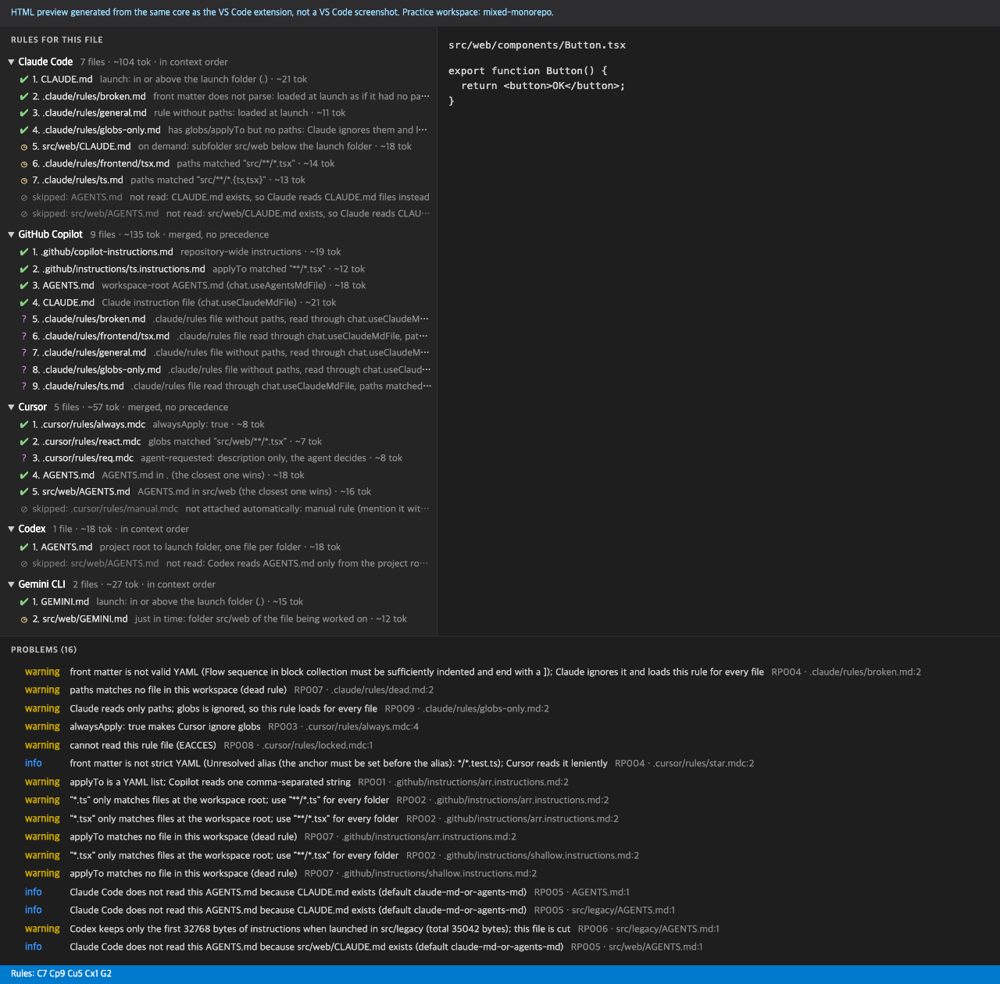
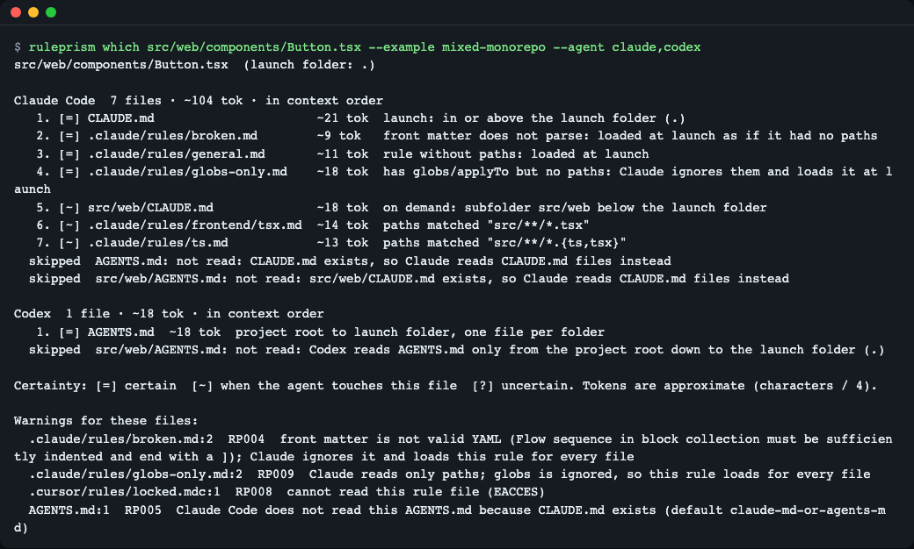
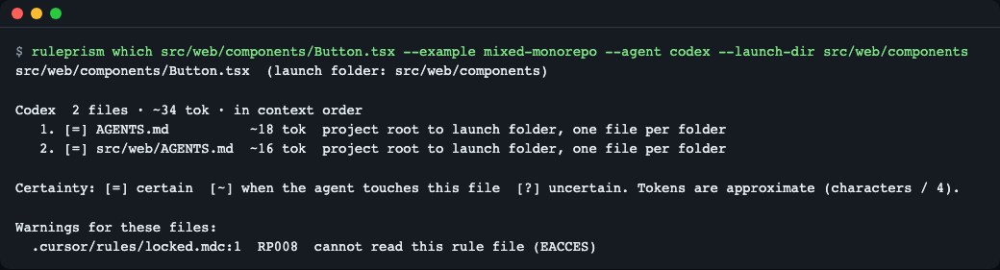
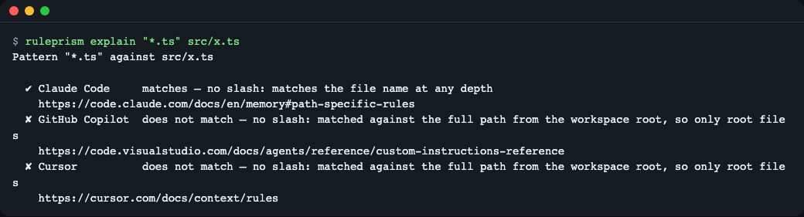
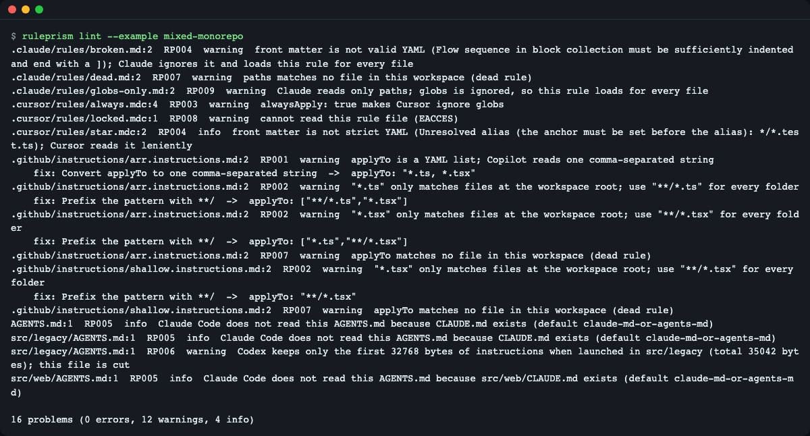
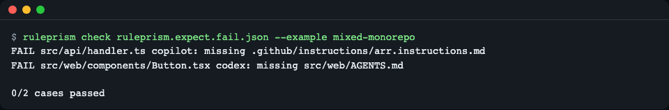
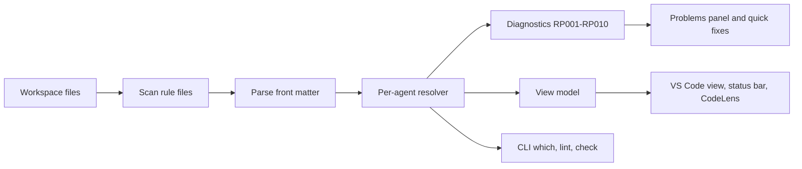

# Ruleprism

**English** | [한국어](README.ko.md)

A VS Code extension (plus a CLI that uses the same code) that shows which instruction files Claude Code, GitHub Copilot, Cursor, Codex and Gemini CLI would attach to the file you have open, in what order and why. It also flags rules that silently fail, such as an `applyTo` list Copilot cannot read or a `globs` key Claude ignores. Not published to the Marketplace or npm yet: build it from source and install the `.vsix` locally (see [Install](#install)).


*HTML preview generated from the same core as the extension, not a VS Code screenshot. It shows the bundled practice workspace `mixed-monorepo`, which was made up for this demo.*

## Why

Every coding agent has its own rules file and its own idea of when to load it. The same pattern `*.ts` matches `src/x.ts` in Claude Code but not in Copilot or Cursor. A Copilot `applyTo` written as a YAML list, or a `globs` key in a Claude rule, fails without any error. You only notice when the agent ignores your rule. Ruleprism applies each tool's documented rules to your files, so you see the answer before you ask the agent.

## What it adds

- **Rules for this file**: an Explorer view listing, per agent, the instruction files attached to the open file, in context order, with the reason (ancestor folder, matched glob, `alwaysApply`, agent-requested, on demand) and an approximate token count.
- **Problems panel**: ten checks (`RP001`-`RP010`) for rules that fail without any error, with quick fixes for two of them.
- **Launch-folder simulation**: Claude Code, Codex and Gemini CLI read different files depending on the folder you start them in. Set the folder and watch the list change.
- **CLI for CI**: `ruleprism check` asserts that a file gets the rule files you expect, and exits 1 if not.
- English and Korean output.

Verdicts follow each tool's documentation (checked 2026-11-14), not observation of a running agent. Every verdict is marked `[=]` certain, `[~]` when the agent touches the file, or `[?]` uncertain. Sources are in [docs/sources.md](docs/sources.md).

## Requirements

| Host | Version | Notes |
|---|---|---|
| VS Code | 1.103 or newer (`engines.vscode`) | Extension. Not yet tested inside a real VS Code window, only with a stubbed `vscode` module (see [Known limits](#known-limits)). |
| Node.js | 22.12 or newer (built and tested with 26.13.0, npm 11.20.0) | Build and CLI. Install: [nodejs.org](https://nodejs.org/) |
| git | any | To clone the repo |

## Install

Ruleprism is not on the VS Code Marketplace or npm yet. Build it from source:

```bash
git clone https://github.com/LeeGyeongPil/ruleprism.git
cd ruleprism
npm install
npm run package          # creates ruleprism-0.1.1.vsix
```

With npm 11 you may see a warning that install scripts of `@vscode/vsce-sign` and `fsevents` were not run. This is expected and harmless: `npm run package` still works.

Install the `.vsix` with the VS Code CLI, or in VS Code run **Extensions: Install from VSIX...** from the Command Palette:

```bash
code --install-extension ruleprism-0.1.1.vsix
```

To try the CLI without VS Code:

```bash
npm start                # compiles, then runs the demo on the practice workspace
node out/cli/main.js --help
```

## Quick start

Run the demo. It uses a practice workspace that ships inside the tool (`mixed-monorepo`, read from memory, made up for this demo):

```bash
npm start
```

Then write the same practice workspace to disk and open it in VS Code with the extension installed:

```bash
node out/cli/main.js demo --write ./ruleprism-demo
code ./ruleprism-demo
```

The command prints a hint that starts with `ruleprism which ...`. In a clone the `ruleprism` command is not on your `PATH` until you run `npm link` once; until then run the same thing as `node out/cli/main.js which ...`.

Open `src/web/components/Button.tsx`. The Explorer shows **Rules for this file**; the status bar shows a summary such as `Rules: C7 Cp9 Cu5 Cx1 G2` (agent letter and file count).

## Usage

### In VS Code

| Where | What you get |
|---|---|
| Explorer > **Rules for this file** | One group per agent. Each entry: order, file, reason, approximate tokens. Skipped files are listed with the reason they are not attached. |
| Status bar | Per-agent file counts for the active file. |
| CodeLens on a rule file | How many files in the workspace that rule matches (`0` means a dead rule). |
| Problems panel | `RP001`-`RP010`. Quick fixes (lightbulb) for `RP001` and `RP002`. |
| Command Palette | `Ruleprism: Refresh`, `Ruleprism: Explain pattern…`, `Ruleprism: Copy result as JSON`, `Ruleprism: Set launch folder…` |

Marks: `✔` certain, `◷` when the agent touches this file, `?` uncertain, `⊘` skipped.

### On the command line

All examples below use the practice workspace through `--example`. For your own repo, replace it with `--root <folder>` (default: current folder). The commands are shown as `ruleprism ...`; in a clone, run `node out/cli/main.js ...` (or `npm link` once).

**`which`**: which files each agent attaches for one file.

```bash
node out/cli/main.js which src/web/components/Button.tsx --example mixed-monorepo --agent claude,codex
```


*Claude Code attaches seven files; `src/web/CLAUDE.md` and the two `paths` rules are `[~]`, loaded only when Claude touches the file. Codex attaches only the root `AGENTS.md`.*

**`--launch-dir`**: pretend the agent was started in another folder.

```bash
node out/cli/main.js which src/web/components/Button.tsx --example mixed-monorepo --agent codex --launch-dir src/web/components
```


*Launched in the file's folder, Codex now also reads `src/web/AGENTS.md`.*

**`explain`**: how one glob pattern behaves in each tool.

```bash
node out/cli/main.js explain "*.ts" src/x.ts
```


*The same pattern `*.ts` matches `src/x.ts` for Claude Code but not for Copilot or Cursor.*

**`lint`**: report rules that fail silently. Exits 1 when it finds warnings (change with `--fail-on error|warning|info|none`), so it works in CI.

```bash
node out/cli/main.js lint --example mixed-monorepo
```


*The practice workspace is built to trigger every check. `lint` exits 1 here on purpose; `lint --example clean-repo` prints `No problems found.` and exits 0.*

| Code | Meaning |
|---|---|
| `RP001` | Copilot `applyTo` written as a YAML list (Copilot reads one comma-separated string). Quick fix. |
| `RP002` | Pattern without `/` such as `*.ts` only matches root files in Copilot and Cursor (for Cursor this is an assumption the docs do not state, so it is info). Quick fix: `**/*.ts`. |
| `RP003` | Cursor `alwaysApply: true` makes `globs` irrelevant. |
| `RP004` | Front matter does not parse (Claude then loads the rule for every file). |
| `RP005` | `AGENTS.md` is not read by Claude Code because a `CLAUDE.md` exists. |
| `RP006` | Codex byte limit cuts this file. |
| `RP007` | The pattern matches no file in the workspace (dead rule). |
| `RP008` | The rule file cannot be read. |
| `RP009` | Claude reads only `paths`; `globs` / `applyTo` in a Claude rule is ignored. |
| `RP010` | The workspace has more than 20,000 files, so counts for dead rules (`RP007`) may be low. Rule files are still all found. Info only. |

**`check`**: assert resolution in CI. An expectation file lists, per file and agent, the rule files that must be attached:

```json
{
  "cases": [
    {
      "file": "src/web/components/Button.tsx",
      "agent": "codex",
      "launchDir": "src/web/components",
      "includes": ["src/web/AGENTS.md"],
      "excludes": ["src/legacy/AGENTS.md"]
    }
  ]
}
```

Keys per case: `file` and `agent` (required), `includes` (rule files that must be attached), `excludes` (rule files that must not be attached), `launchDir` (folder the agent is assumed to start in, default: the workspace root). The case above passes: with the launch folder set, Codex attaches `src/web/AGENTS.md`. Without `launchDir` the same case fails, because Codex started at the root does not read it. The bundled `ruleprism.expect.fail.json` leaves `launchDir` out on purpose, so it fails:

```bash
node out/cli/main.js check ruleprism.expect.fail.json --example mixed-monorepo
```


*Exit code 1 with one `FAIL` line per missing rule. `ruleprism.expect.json` (the passing example) prints `3/3 cases passed` and exits 0.*

Add `--json` to `which`, `lint` or `check` for machine-readable output (`"schemaVersion": 1`). Exit codes: 0 ok, 1 `check` failed or `lint` found problems, 2 usage or input error (message on stderr as `error:` plus `hint:`).

### How each agent is resolved

A short summary; the full tables with source URLs are in [docs/sources.md](docs/sources.md) (checked 2026-11-14).

| Agent | What is read, in what order | Launch folder | Certainty |
|---|---|---|---|
| Claude Code | `CLAUDE.md` and rules without `paths` from the root down to the launch folder (root first); `paths` rules and `CLAUDE.md` files in subfolders when the agent touches the file; `AGENTS.md` only if no `CLAUDE.md` exists | Folders at or above it load at start, folders below it on demand | `[=]` at start, `[~]` on demand |
| GitHub Copilot | `.github/copilot-instructions.md`, matching `.github/instructions/*.instructions.md` (`applyTo`, relative to the workspace root), root `AGENTS.md` and `CLAUDE.md` (both settings default to on). Merged, no documented order | Not used | `[?]` for `applyTo` lists and `.claude/rules` |
| Cursor | `.cursor/rules/*.mdc`: `alwaysApply`, matching `globs`, agent-requested (`description` only), manual | Not used | `[?]` for description-only and nested rules |
| Codex | One `AGENTS.md` (or `AGENTS.override.md`) per folder from the project root down to the launch folder, cut at 32 KiB in total | Folders below it are not read | `[=]` |
| Gemini CLI | `GEMINI.md` from the launch folder up to the `.git` folder at start; files in the opened file's folder just in time | Sets which folders load at start | `[=]` at start, `[~]` just in time |

### Use in CI

`ruleprism check` reads an expectation file (see above) and exits 0 when every case passes, 1 when a case fails, 2 on a usage or input error. Ruleprism is not on npm yet, so the job below clones a tagged release (`v0.1.1`), builds it, and runs `check` against your repository. `actions/setup-node` puts Node on the `PATH`; the action versions are the ones this repository's own CI uses.

```yaml
name: rules
on: [push, pull_request]
jobs:
  ruleprism:
    runs-on: ubuntu-latest
    steps:
      - uses: actions/checkout@v7.0.1
      - uses: actions/setup-node@v7.1.0
        with:
          node-version: 22.x
      - name: Build ruleprism
        run: |
          git clone --depth 1 --branch v0.1.1 https://github.com/LeeGyeongPil/ruleprism.git "$RUNNER_TEMP/ruleprism"
          cd "$RUNNER_TEMP/ruleprism"
          npm ci
          npm run compile
      - name: Check rule resolution
        run: node "$RUNNER_TEMP/ruleprism/out/cli/main.js" check ruleprism.expect.json
```

I ran the same steps in a clean folder: the build, then `check ruleprism.expect.json` against the demo workspace printed `3/3 cases passed` (exit 0), and `check ruleprism.expect.fail.json` printed two `FAIL` lines and `0/2 cases passed` (exit 1), which fails the job. Add a `lint` step the same way (`... lint`; exit 1 on warnings, change with `--fail-on`).

### Language

CLI language: `--lang en|ko`, then `RULEPRISM_LANG`, then `LC_ALL`, `LC_MESSAGES`, `LANG` (first one set decides; a value starting with `ko` means Korean, anything else English). Extension: setting `ruleprism.language` (`auto` follows the VS Code display language).

## Settings

| Key | Default | Description |
|---|---|---|
| `ruleprism.agents` | all five | Agents to show: `claude`, `copilot`, `cursor`, `codex`, `gemini`. |
| `ruleprism.launchFolder` | `workspaceRoot` | Folder the agent is assumed to start in: `workspaceRoot`, `fileFolder`, or a path relative to the workspace root. |
| `ruleprism.includeUserFiles` | `true` | Include `~/.claude/CLAUDE.md`, `~/.claude/rules`, `~/.codex/AGENTS.md`, `~/.gemini/GEMINI.md`. The CLI includes them only with `--user`. |
| `ruleprism.claude.instructionFiles` | `claude-md-or-agents-md` | Claude Code "project instructions" mode: read `AGENTS.md` only when there is no `CLAUDE.md`, or `claude-md-and-agents-md` to read both. |
| `ruleprism.codex.maxBytes` | `32768` | Codex total byte limit for project instructions (`project_doc_max_bytes`). |
| `ruleprism.gemini.fileNames` | `["GEMINI.md"]` | Gemini CLI context file names. |
| `ruleprism.language` | `auto` | `auto`, `en` or `ko`. |

The extension also reads your real Copilot settings `chat.useAgentsMdFile` and `chat.useClaudeMdFile`; the CLI assumes their documented defaults (both on).

## How it works



- **Scan and parse**: finds rule files (skips `node_modules`, `.git`, `out`, `dist`; does not follow symlinks; rule files are always found, only the general file list used for dead-rule counts stops at 20,000 files) and reads their front matter. Broken front matter is reported, not thrown.
- **Per-agent resolver**: one module per tool, each with the documentation URLs it follows. Glob rules differ per tool, for example `*.ts` matches at any depth in Claude Code but only at the root in Copilot and Cursor.
- **Same core everywhere**: the extension, the CLI and the HTML preview call the same code. The core never imports `vscode` (a test enforces it).
- **Access**: reads files inside the workspace (and the few user-level paths above when enabled). No network, no telemetry, no child processes.

## When to use it

- Good fit: you use more than one coding agent in the same repo and want to see, while editing, which rules each one gets; or you want CI to fail when a rule stops attaching.
- Other tools: if you only want a command-line answer to "which instruction files apply to this file", see [whichrules](https://github.com/z35068037/whichrules). Check its page for what it covers today.

## Known limits

- Verdicts come from documentation, not from watching an agent. Behavior can change between agent versions.
- The `ruleprism.language` setting covers the view, reasons and diagnostics. The extension's prompts, pickers and info messages (for example in **Explain pattern…** and **Set launch folder…**) follow the VS Code display language instead, so setting `ruleprism.language` to a different language than VS Code gives mixed-language output. With `auto` nothing is mixed.
- For Cursor, a pattern without `/` such as `*.ts` is shown as no match, but the Cursor docs do not state this; it is an assumption and is not marked `?` in `explain` yet.
- In the Cursor group, `AGENTS.md` files in the root and in subfolders all appear. "The closest one wins" in the reason text describes which file takes precedence if instructions conflict, not that the others are left out.
- Not modeled yet: `@path` imports, Claude `claudeMdExcludes`, managed policy files, symlinked rules, Codex `project_doc_fallback_filenames`, Gemini `@file` imports. Full list: [docs/sources.md](docs/sources.md).
- The extension was tested with a stubbed `vscode` module (activate, tree, status bar, diagnostics, quick fixes, CodeLens, commands, dispose), not yet in a real VS Code window or extension-host test. The README images are HTML previews, not VS Code screenshots.

## Troubleshooting

| Symptom | Cause | Fix |
|---|---|---|
| The view is empty | No rule file in the workspace, so the extension never activated | Open a folder that has `CLAUDE.md`, `AGENTS.md`, `.cursor/rules` or similar. |
| A rule you expect is missing for Claude Code | `AGENTS.md` is hidden by `CLAUDE.md` (`RP005`) | Set `ruleprism.claude.instructionFiles` to `claude-md-and-agents-md` if you use that Claude Code setting. |
| Codex list differs from what you expect | Codex reads only from the project root down to the launch folder | Set `ruleprism.launchFolder` or `--launch-dir`. |
| `error: ... is outside the workspace root` (exit 2) | The file path is not under `--root` | Pass a path inside the root, or change `--root`. |
| `code: command not found` | VS Code shell command is not installed | Use **Extensions: Install from VSIX...** in the Command Palette. |

## Development

```bash
npm install
npm test               # compiles, then runs 119 tests
npm run typecheck
npm run package        # builds the .vsix
npm run preview        # writes docs/preview/sidebar.en.html and sidebar.ko.html
```

To run the extension from source in VS Code, open this folder and press F5 (**Run Extension**; create a launch configuration if prompted).

Changes are listed in [CHANGELOG.md](CHANGELOG.md).

## License

MIT.
